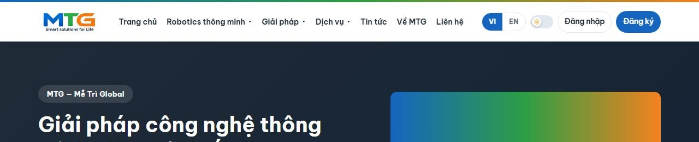
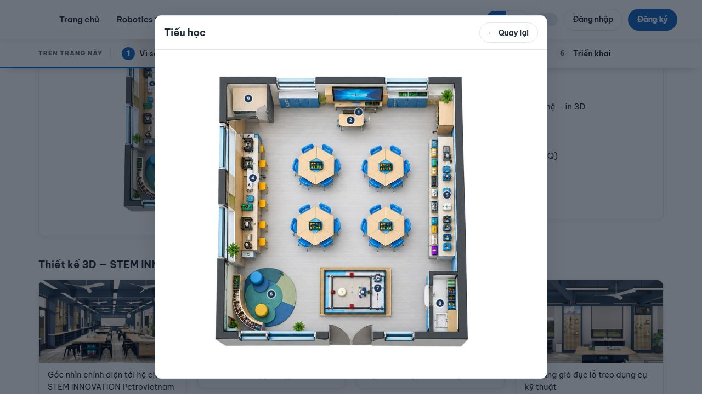
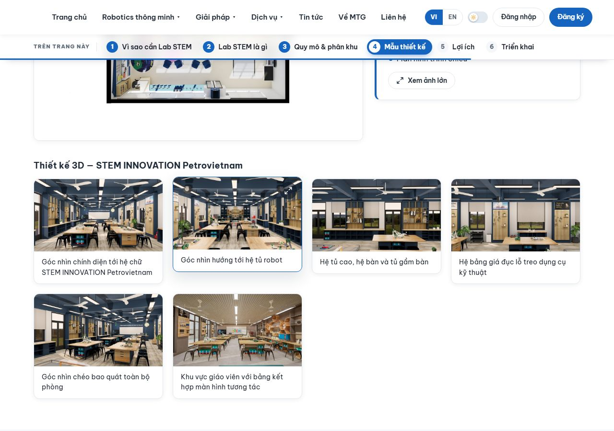
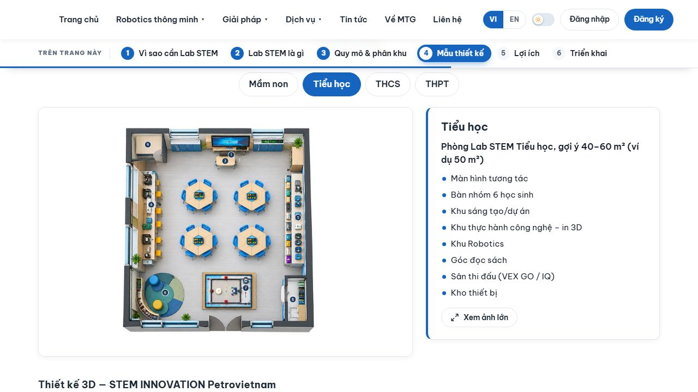

# Changelog

All notable changes to the MTGlobal website are listed here, newest first.

Each commit published to GitHub is one version: the first commit is **1.0.0** and every later commit adds one to the last number (1.0.1, 1.0.2, …). The format follows [Keep a Changelog](https://keepachangelog.com/). From 1.0.10 on, versions with visible changes include screenshots.

---

## [1.0.11] - 2026-10-19

### Changed
- **README:** the guide (English and Tiếng Việt) and its screenshots now match the current website. It adds the Giải pháp section menu, the STEM Lab sample rooms with "Xem ảnh lớn", the "Thiết kế 3D" pictures, the equipment page's tabs and topic search, the light/dark switch and the dashboard charts, with new pictures of the STEM Lab and equipment pages.

### Fixed
- **The MTG logo was missing for visitors who were not logged in**: the menu, the light/dark switch and the "Đăng nhập" / "Đăng ký" buttons left it no room, so it shrank to nothing. It now always shows at full size. To make room, the menu is a little tighter on wide screens, it moves into the ☰ button below 1241 px wide (as on smaller screens before), and on phones "Đăng ký" is reached from the login page.

  

  

## [1.0.10] - 2026-10-19 · `a81997e`

### Added
- **"Xem ảnh lớn" on "Mẫu thiết kế phân khu theo cấp học"** (STEM Lab page): the whole room drawing opens in a box in the middle of the page, with "← Quay lại"; Esc, a click outside or the browser's Back button also close it. It works in Chrome, Edge, Opera, Firefox and Cốc Cốc; if an ad-blocking extension hides the box, the picture opens on its own instead, and Back returns to the page.

  
- **"Thiết kế 3D" pictures** (STEM Lab page): under the mouse a picture lifts slightly, zooms in gently and shows an expand icon (on phones the icon is always shown); a click or tap opens it larger in the same box, with its caption as the title.

  
- **Equipment search** (on the STEM equipment page and in Admin → Sản phẩm) also finds items by the topic of their sub-list, e.g. "rô bốt" finds the items under "Lập trình & Rô-bốt giáo dục".

### Changed
- **"Mẫu thiết kế phân khu theo cấp học"**: each school level shows its room drawing on the left and its description on the right, as a short list of the room's areas (one under the other on phones). Mầm non and THCS get a fuller description, like Tiểu học and THPT.

  
- **"Xem chi tiết"** on cards opens and closes smoothly instead of jumping.

## [1.0.9] - 2026-10-18 · `d318fe6`

### Added
- **Log in with Google:** a "Đăng nhập bằng Google" button on the login and sign-up pages, shown once Google keys are set in `.env` (steps in the README). Name, email and photo come from the Google account at each Google login; an existing account with the same email is joined, keeping its role and requests. A Google-only account can set a password later in Profile.
- **"Đăng nhập thành công" notice** after logging in (password or Google): it slides in under the header and slides back out after a few seconds, or with ×; it stays while the pointer is on it.
- **Profile photo "Xóa ảnh" button** (asks first): the two letters of the name come back; a deleted Google photo doesn't return at the next Google login.
- **Changing a sent request:** in "Yêu cầu của tôi", requests that are still "Mới" have a "Sửa" button that opens the request form filled in; once staff act on a request it is locked ("Đang xử lý" / "Đã xử lý"). Staff see "Đã sửa lúc …" on changed requests.
- **Thank-you card after sending a request**, with "← Quay lại biểu mẫu" and "Xem yêu cầu của tôi"; reloading it no longer sends the request twice.
- **Requests need an account:** a logged-out visitor is taken to the login page ("Xin hãy đăng nhập để yêu cầu tư vấn"); the robot and service pages show a login box instead of the form. Logged-in forms start from the profile (name, email, phone, organisation), still editable.
- **Robot requests record the robot**, shown under "Quan tâm" in the admin request list and in "Yêu cầu của tôi".
- **Dashboard:**
  - "Yêu cầu theo tháng": each month's column is split into Mới / Đã liên hệ / Hoàn tất, with a key below; the line joins each month's total.
  - A **"Tỉ lệ" panel with two tabs**: "Theo mục quan tâm" (Giải pháp STEM, Sản phẩm, Dịch vụ, Khác; click a group to open its own pie, with a way back) and "Thiết bị, học liệu, Robot STEM" (the catalogue by part).
- **Admin → Người dùng:** filter buttons by role (Chủ sở hữu / Quản trị viên / Khách hàng) with counts, and a search by name, email or organisation; profile photos show as small pictures that open larger.
- **Admin searches:** robots, and consultation requests with category chips.
- **Cài đặt chung → "Khôi phục"** tab: put chosen Giải pháp pages back to their default content, with checkboxes per page.
- **Tập huấn page:** a "Khám phá VEX Robotics" button to the VEX Robotics website; the number cards light up on hover.
- **Sign-up checks:** name required, a valid email, matching passwords, at least 6 characters (counted while typing); phone and school are optional. After signing up the login page opens with the email filled in, and every role lands on Trang chủ after logging in.

### Changed
- **Giải pháp page editors:** an outline of sections with one item open at a time, Vietnamese and English side by side, move up/down, "Hoàn tác" after removing, and a warning before leaving unsaved changes. Button links and display options are left to the developer.
- **"Ảnh & video" in the editors:** one numbered row per photo with its caption in both languages; the "Hiện trọn ảnh" box is gone.
- **Page banners** (Cài đặt chung): edited per page with a preview.
- **"Bạn quan tâm đến"** in the request form is grouped (Giải pháp STEM / Sản phẩm / Dịch vụ / Khác) with the full list of choices; each Giải pháp page's button picks its own choice.
- **Giải pháp pages:** the section menu appears after scrolling past the banner, numbered, with reading progress; the step trail moves slower and reacts to the pointer; switching VI/EN keeps the reading position.
- **Admin notifications** slide in from the right and back out off the screen (on phones from and to the bottom), also with "reduced motion" on, and stay while the pointer is on them.

### Removed
- The row of two buttons under the key numbers on the "Tư vấn, thiết kế và triển khai phòng Lab STEM" page (the closing sections already lead there).
- The status pie on the dashboard (the monthly columns now show the statuses).

## [1.0.8] - 2026-10-17 · `e9d6d72`

### Added
- **Automatic tests** (`npm test`): one command checks the whole website and admin area in a real browser and prints only what fails. Test data is temporary and removed afterwards.
- **Release script** (`npm run release`): one command dates the changelog, makes the commit and the version tag, and publishes the GitHub Release with the full changelog.
- `CLAUDE.md`: working notes for Claude (how the project is built and run, tests, the release routine).

### Changed
- The site's styles are split into six files by area (base, layout, shared parts, home page, content pages, admin). Public pages no longer load the admin styles. Every page looks exactly as before.
- `package.json` now shows the current version number.

## [1.0.7] - 2026-10-16 · `fa0ff18`

### Added
- Version tags (v1.0.0–v1.0.7) and a GitHub Release for every version, with the notes from this file.

### Changed
- The README links to the changelog and the Releases page right at the top.

## [1.0.6] - 2026-10-16 · `fab5e7d`

### Added
- **Partner pages** (`/doi-tac/<name>`): each partner logo opens its own page with a description (VI/EN), a "Visit website" button and contact details (emails and phone numbers are clickable). The admin partner form gains description, contacts, website and page-address fields. Seven partners are loaded with logos, descriptions and contacts.
- **Dashboard charts:** "Requests per month" combines bars (received) with a line (completed), with a glow on the hovered month; "Processing status" is a pie with a radial sweep when the page opens and slices that slide out on hover; the category bars and the pie are linked to their legends.
- **Consultation requests:** a **Delete** button on each request, with a confirmation dialog; the status filter is kept after deleting.
- **Admin filters and searches:**
  - *Equipment, materials & STEM robots*: filter chips per part (Phần I–IV) that work together with the name search; drag-sorting pauses while filtering; the filter and search survive going back from an edit page.
  - *Reference projects*: search by school name (and place), school-level chips and a level column.
  - *News*: search by title (VI/EN) with matches highlighted.
- **School levels for reference projects** (THCS / THPT / Đại học / Khác): detected from the school name, or chosen in the project form.
- **Public pages:**
  - *Equipment page*: one tab per part with item counts, plus a search across all parts (accents not needed).
  - *Reference projects*: sections per school level (THCS, THPT, Đại học, and "Khác" when used) and a search by school name.
  - *News*: search by title and article text.
  - *Process steps* on the Solutions pages are drawn as a numbered trail that fills in as it scrolls into view.
- **STEM Lab page:** key facts at the top, a sticky jump menu that marks the section being read, picture tabs for the sample rooms (Mầm non / Tiểu học / THCS / THPT), a folded legal-basis panel and short zone cards with "Xem chi tiết".
- **Page editor (Admin → Giải pháp):** a "Display" option per section (*folded under its title*, *short cards*, *tabs* for photos) and an optional short name for the jump menu.
- **"Khám phá thêm" closing section** on all six Solutions pages: link cards to the other Solutions pages and a blue consultation band (a page's own closing buttons, such as "Đăng ký workshop", feed into it).
- **Services landing page** (`/dich-vu`): one card per service and the consultation band.
- **Menu:** clicking *Smart Robotics*, *Solutions* or *Services* opens its overview page; hovering still opens the dropdown.
- **Watch-only videos:** play/pause, time bar, volume and fullscreen only; no download button, playback speed, picture-in-picture, casting or right-click "Save video as"; opening a video file directly in a tab is refused.
- `CHANGELOG.md` (this file).

### Changed
- **STEM Lab page restructured** to be easier to read: long paragraphs became short bullet lists, with every fact kept.
- **Dashboard animations:** the pie sweep takes 1 second with a smooth ease and a gentle fade/grow; the line draws quickly at first and slows towards the latest month (1.6 s), each dot popping as the line reaches it. Both play the same on every device.
- **Dashboard:** the chart legend sits under the chart, centred; chart highlights follow the mouse only (a click no longer locks a column, slice or row); the "Khách hàng" tile no longer counts administrators.
- **Home "What We Do":** the two service cards are merged into one "Dịch vụ" card (7 areas instead of 8).
- **Partner logos:** white tiles, at most 6 per row (extra logos start a new, centred row; 4 per row on tablets, 3 on phones); on hover a tile floats up with a blue glow around it.
- **Project cards** lead with the school name (the project names are much alike).
- Admin list search texts are now specific to each list.

### Fixed
- The admin side menu keeps its scroll position when moving between pages.
- The "Sắp ra mắt" (coming soon) overlay on robot cards was invisible in dark mode; it is now a light frosted layer with a clear badge.
- News cards showed the Vietnamese title on the English site.
- Opening "Xem chi tiết" on one zone card stretched the card next to it.
- The jump menu covered the top few pixels of the section it scrolled to.

## [1.0.5] - 2026-10-15 · `5947ac7`

### Added
- **Show/hide password** (eye button) on all six password boxes (login, register, profile); keyboard accessible; boxes go back to hidden when the form is sent and when returning via back/forward.

### Changed
- Login, register and profile forms give browsers the right hints, so a saved password can be filled into "Mật khẩu hiện tại" (passwords stay hashed).
- Form labels are linked to their inputs.

## [1.0.4] - 2026-10-14 · `300b9eb`

### Removed
- Unused README screenshot (`solution-workshop`, EN and VI).

## [1.0.3] - 2026-10-14 · `37320cd`

### Changed
- **README rewritten for business users:** "In short", an "I want to…" task table, short visitor and staff guides with four screenshots, and folded "More details" / installation boxes; no technical terms outside the IT box. It covers the home slider, Solutions page, hover menus and profile role.
- About 1,500 words instead of 5,000.

### Removed
- Screenshots no longer used by the README.

## [1.0.2] - 2026-10-14 · `96d4df2`

### Added
- **Home "Lĩnh vực hoạt động" slider:** eight business-area cards (3½ in view) with smooth sliding by mouse wheel, drag, keyboard and arrow buttons, settling on card edges; the wheel over the cards never scrolls the page.
- Pages opened from a slider card show "← Về trang chủ", returning to the slider where it was.
- **Solutions landing page** (`/giai-phap`) with the six solution cards, linked from the footer; its banner line is editable in General settings.
- The profile page shows the account role (view only).

### Changed
- Header dropdown menus open on hover only; a click no longer pins them open. Keyboard access is kept (Tab / Esc).
- README screenshots refreshed.

## [1.0.1] - 2026-10-14 · `f0c9bf0`

### Added
- **README** (English, then Vietnamese): overview, features, user guide for visitors and admin staff, local installation, configuration and admin account setup, with screenshots.
- **LICENSE:** proprietary, all rights reserved (`package.json` marked `UNLICENSED`).

### Removed
- `SETUP_GUIDE.txt` (replaced by the README).

## [1.0.0] - 2026-10-14 · `0daaa91`

First release of the MTGlobal website: Node.js / Express, EJS templates and MongoDB, in Vietnamese and English.

### Added
- **Public website:**
  - Home page with hero, business areas, smart-robot products, featured projects and partners.
  - *Smart Robotics*: product list and product pages (photos, videos, specifications, "coming soon" products, quote request).
  - *Solutions*: STEM Lab consulting, Workshops, Training and Training & rollout pages; STEM equipment catalogue (VEX Robotics ecosystem) with item pages; reference projects.
  - *Services*: study-abroad consulting and technology distribution pages with packages and their own request questions.
  - News, About (with partners), Contact and consultation request forms.
  - Accounts: register, log in, profile (avatar, bio, password change) and "My requests" with status.
  - Light / dark theme and VI / EN language switch.
- **Admin area:**
  - Dashboard with key figures and recent requests.
  - Robot products and STEM equipment (separate lists, name search for equipment), reference projects, services, partners and news, all with drag-and-drop ordering.
  - Editable Solutions pages built from blocks (text, cards, steps, photos & videos, numbers, buttons), with "restore default content".
  - Consultation requests with statuses *New → Contacted → Completed*.
  - Users and roles (Owner / Administrator / Customer).
  - General settings (logo, home hero, page banners) and company info; separate admin language.
- Setup and data scripts (seed data, make an admin, STEM equipment data).
