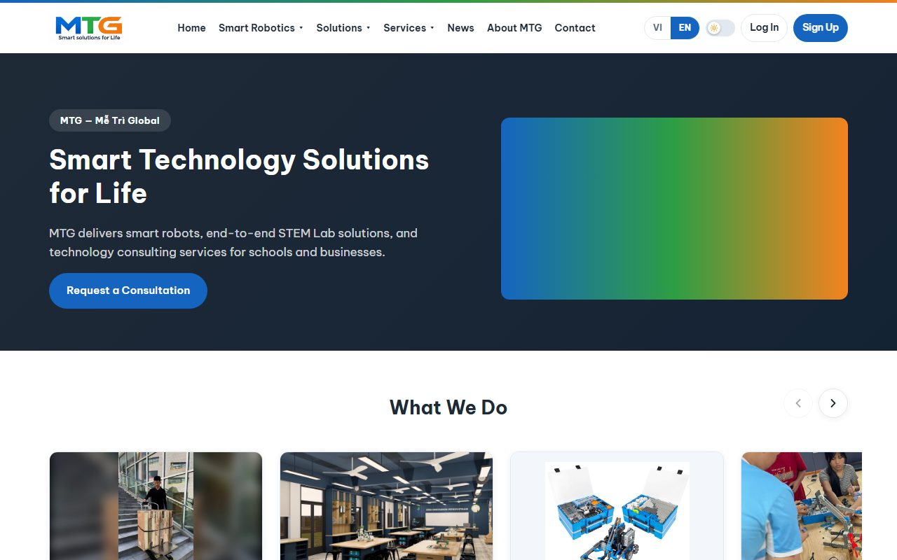
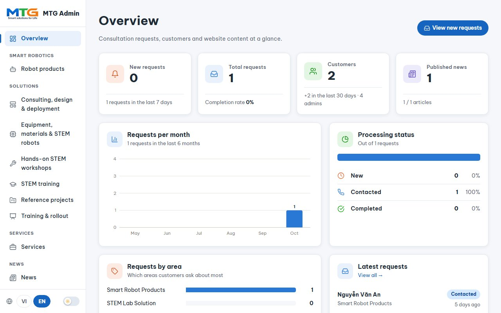
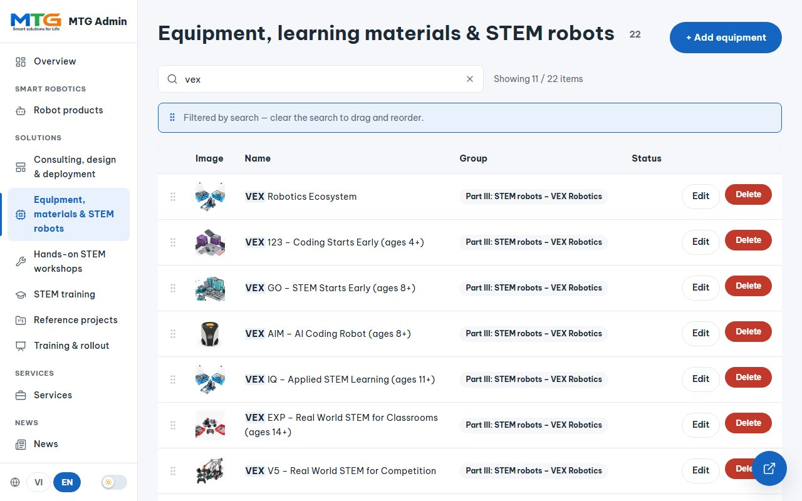
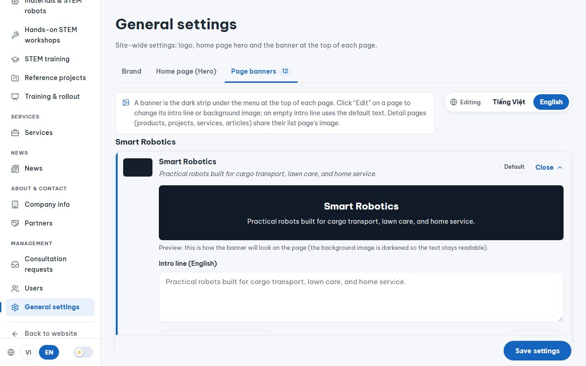
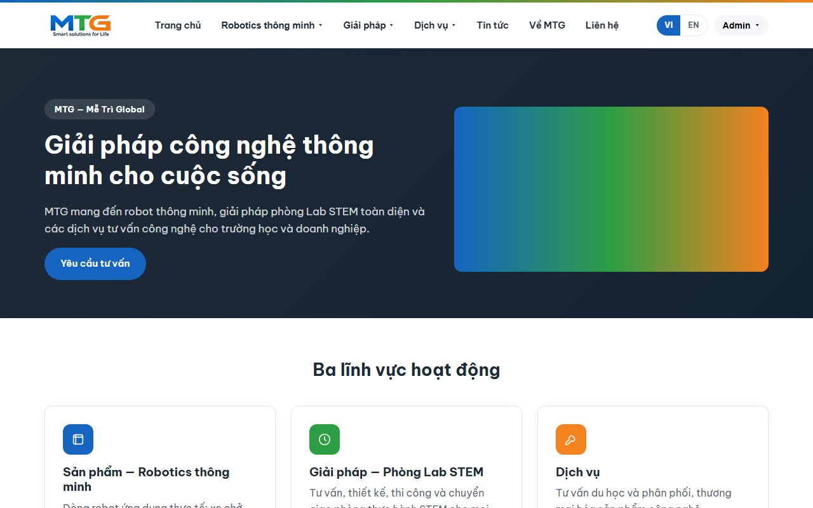
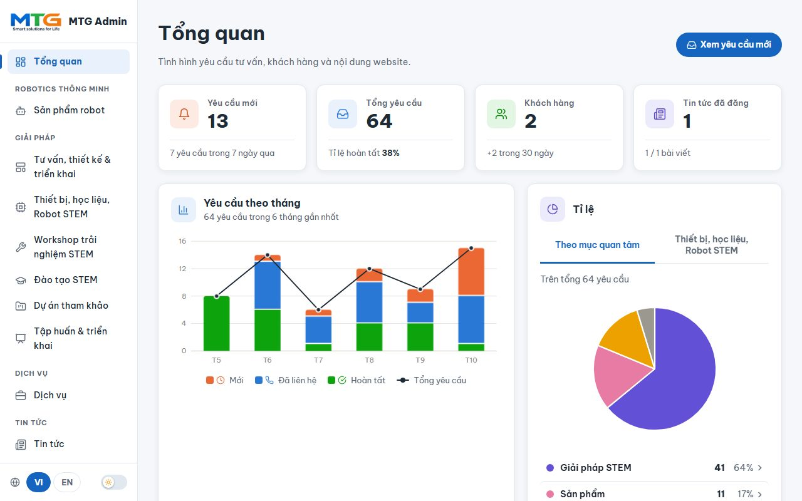
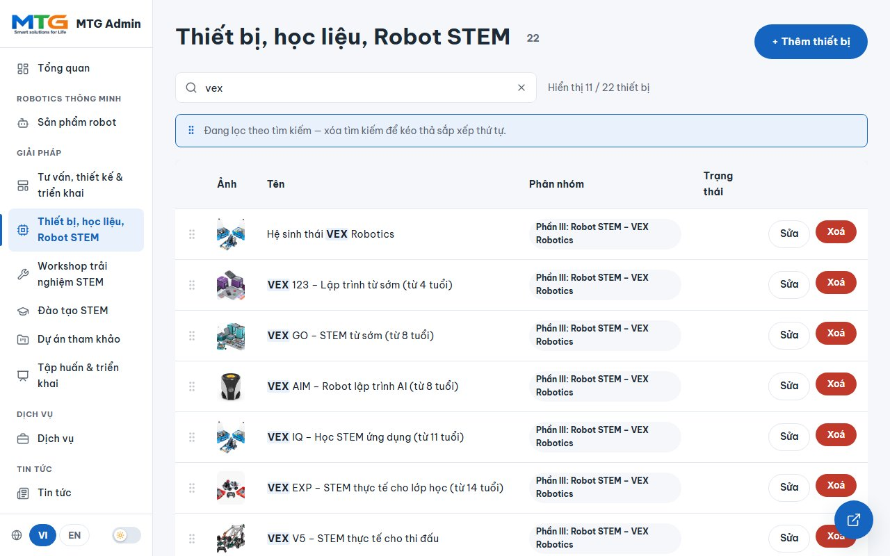
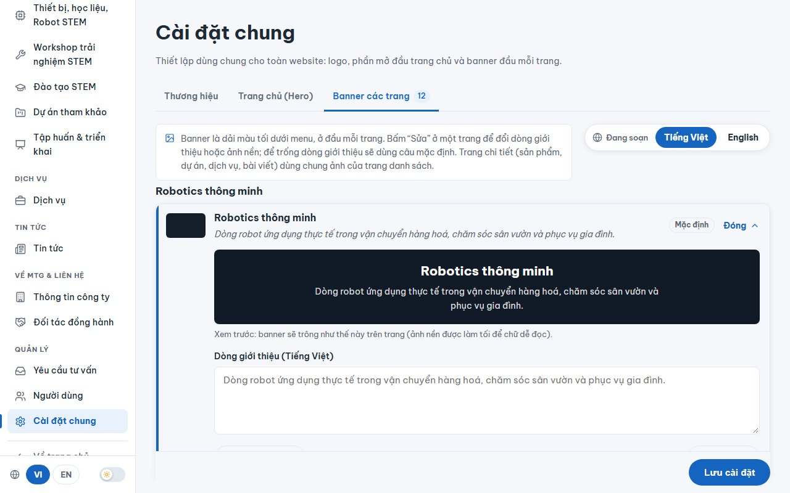

# MTGlobal — Smart Solutions for Life

The bilingual (Vietnamese / English) website of **Công ty TNHH Công nghệ Mễ Trì Global (MTG)**, with an admin area to update it.

**[English](#english)** · **[Tiếng Việt](#tiếng-việt)**

📋 **[Changelog](CHANGELOG.md)** · **[Releases](https://github.com/KClabio/MTGlobal/releases)** — what changed in each version / thay đổi của từng phiên bản

---

## English

### In short
- **The website** shows MTG's robots, STEM lab solutions and services, in Vietnamese and English.
- **To change anything**, sign in and open **Admin** (address ending in `/admin`). No coding needed.
- **Stuck?** Ask the person who owns the website (the *Owner* account).

### I want to…

| I want to… | Go to (in Admin) |
|---|---|
| Add or edit a robot | **Robot products** |
| Add or edit STEM equipment | **Equipment, materials & STEM robots** |
| Edit a Solutions page (Workshop, Training…) | Its name under **Solutions** |
| Add a reference project | **Reference projects** |
| Post news | **News** |
| Change the logo, home picture or a page banner | **General settings** |
| Change company address, phone, email | **Company info** |
| Add or edit a partner (logo, its own page, contacts) | **Partners** |
| See customer requests | **Consultation requests** |
| Make someone an admin | **Users** (Owner only) |

### For visitors
- **Menu:** point at *Smart Robotics*, *Solutions* or *Services* to see their pages; click the name itself to open its overview page.
- **Videos** can be watched (play, time bar, volume, fullscreen) but not downloaded.
- **Home page:** scroll the **What We Do** cards sideways (mouse wheel, arrows or drag) and click one to open it.
- **Language:** **VI / EN** at the top right.
- **Partners:** click a partner logo to read about it and open its website.
- **Reference projects:** grouped by school level (lower secondary, upper secondary, university); search by school name.
- **News:** search by title or text.
- **Ask for advice:** log in first (a visitor who isn't logged in is taken to the login page). Then fill in the form on **Contact** (or on a robot or service page); your name, email, phone and organisation from your profile are already filled in and can be changed.
- **Your account:** **Sign Up** (name, email and password; phone and organisation are optional), then **Log In** with the new account, or simply use **Log in with Google**. After logging in you land on the home page. See your requests in **My Requests** and your details and role in **Profile**.
- **After sending a request:** the thank-you card has **← Back to the form** and **See my requests**. In **My Requests**, **Edit** changes a request while it is still *New*; once MTG starts on it, it is locked. Staff see "Edited …" with the time.
- **Logging in with Google:** your name, email and photo come from your Google account each time you log in that way (the name can't be changed on the website). If you already have an account with the same email, it's the same account. You can also set a password in **Profile** to log in with email and password.
- **Profile photo:** **Choose photo** to upload one; **Delete photo** takes it away and the two letters of your name come back.

### For staff: the admin area
**Sign in:** log in (you land on the home page) → open the name menu at the top right → **Admin**.

**Everyday basics**
- **Add:** the blue **+ Add…** button. **Change:** **Edit** on a row. Then **Save**.
- **Two languages:** fill in Vietnamese and English. If English is empty, Vietnamese is shown.
- **Order:** drag a row by its ⠿ handle. The website follows the new order.
- **Find:** type in the search box (accents not needed: `may in` finds "máy in"). Robots, equipment, reference projects, news and consultation requests have one. Equipment can also be filtered by part (*Part I…IV*), reference projects by school level, requests by interest.
- **Delete:** **Delete**, then confirm.
- **See the result:** the round button at the bottom right opens the page on the website.
- **Admin language:** **VI / EN** at the bottom of the left menu.

<b>More details</b> (click to open)

**Solutions pages** (Consulting, Workshops, Training, Training & rollout)
- A page is a short list of sections: text, cards, steps, photos & videos, numbers or buttons. Each line shows the type, the title and what it holds ("3 cards").
- **Edit** opens one section at a time. Inside it, cards, steps, numbers and buttons are short lines too: **Edit** on a line opens just that one. **Add a section** at the bottom asks which kind first.
- Vietnamese boxes are on the left, English on the right. An empty English box shows the Vietnamese text in grey, and an orange **EN** mark shows a section or card that still lacks English.
- Move with ⠿ or ▲ ▼. The bin deletes; **Undo** in the notification brings it back. Nothing changes on the website until **Save page** ("Unsaved changes" shows next to it).
- **Set by the developer, not in the admin:** buttons and their links (in a "Buttons" section you can only change the wording), and how a section is displayed (type, columns, folded, short cards, tabs, picture shape, short name in the page menu). Saving keeps them as they are.
- **Photos & videos:** one row per picture: its number, a large preview, and the caption in Vietnamese (left) and English (right). The header shows how many there are; **+ Add photos/videos** is next to it.

**General settings** has four tabs:
- **Brand:** the logo.
- **Home page (Hero):** the big home picture and its title. Leave a box empty to keep the current text.
- **Page banners:** the dark strip at the top of each page. One line per page shows its current text and whether it is *Default*, *Edited* or *Has image*. **Edit** opens a preview of the banner, the intro line in Vietnamese (left) and English (right) (empty = default text; **Use the default line** empties both) and the background picture.
- **Restore defaults:** tick one or more Solutions pages, then **Restore the chosen pages** puts their original content back (after confirming; it can't be undone).

**Consultation requests:** set each one to *New → Contacted → Completed*. The customer sees the same status. **Delete** removes a request for good (after confirming). Search by name, organisation, phone, email or message, and filter by interest, on every status tab. A request sent from a robot's page names the robot ("Product: …"), and the search finds it by the robot's name.

**Reference projects:** the school level is taken from the school name (THCS / THPT / Đại học); choose **School level** in the form to set it by hand.

**Who can do what**

| Role | Can |
|---|---|
| **Owner** | Everything, including giving or removing admin rights |
| **Administrator** | Edit all content and handle requests |
| **Customer** | Use the website and send requests |

Roles are shown on each person's profile and can only be changed by an Owner in **Users**. **Users** also shows each person's profile photo (or their initials); click a photo to see it larger. The buttons above the list show only Owners, Admins or Customers, and the search box finds a person by name, email or organisation.

<b>For the IT person:</b> install on a computer

Needs Node.js 18+ and MongoDB.

1. `git clone https://github.com/KClabio/MTGlobal.git` then `cd MTGlobal`
2. `npm install`
3. Copy `.env.example` to `.env` and set `SESSION_SECRET` to any long random text.
4. `npm run seed` (first time only — it **replaces** projects, products and services), then `npm run dev` and open http://localhost:3000
5. First admin: sign up on the website, then `npm run make-admin -- your@email.com --owner` and log in again.

Uploaded photos and the database are not stored in this repository — copy them from the current computer when moving.

**"Log in with Google"** (optional; the button stays hidden until this is done):
1. Open https://console.cloud.google.com and create a project (for example "MTGlobal").
2. **APIs & Services → OAuth consent screen:** choose *External*, app name *MTGlobal*, your support email; save.
3. **APIs & Services → Credentials → Create credentials → OAuth client ID:** type *Web application*.
4. Under **Authorised redirect URIs** add `http://localhost:3000/dang-nhap/google/callback` and, for the real website, `https://<your-domain>/dang-nhap/google/callback`.
5. Copy the **Client ID** and **Client secret** into `.env` as `GOOGLE_CLIENT_ID=` and `GOOGLE_CLIENT_SECRET=`.
6. Stop `npm run dev` (Ctrl+C) and start it again: changes to `.env` are only read at start.

**What's new:** see [CHANGELOG.md](CHANGELOG.md) for the changes in each version.

**License:** © 2026 Công ty TNHH Công nghệ Mễ Trì Global. All rights reserved — see [LICENSE](LICENSE).

---

## Tiếng Việt

### Tóm tắt
- **Website** giới thiệu robot, giải pháp phòng Lab STEM và dịch vụ của MTG, bằng tiếng Việt và tiếng Anh.
- **Muốn thay đổi nội dung**, đăng nhập rồi mở **Quản trị** (địa chỉ kết thúc bằng `/admin`). Không cần biết lập trình.
- **Gặp khó khăn?** Hỏi người quản lý website (tài khoản *Chủ sở hữu*).

### Tôi muốn…

| Tôi muốn… | Vào (trong Quản trị) |
|---|---|
| Thêm / sửa robot | **Sản phẩm robot** |
| Thêm / sửa thiết bị STEM | **Thiết bị, học liệu, Robot STEM** |
| Sửa một trang Giải pháp (Workshop, Đào tạo…) | Tên trang đó trong nhóm **Giải pháp** |
| Thêm dự án tham khảo | **Dự án tham khảo** |
| Đăng tin tức | **Tin tức** |
| Đổi logo, ảnh trang chủ hoặc banner trang | **Cài đặt chung** |
| Đổi địa chỉ, điện thoại, email công ty | **Thông tin công ty** |
| Thêm / sửa đối tác (logo, trang giới thiệu, liên hệ) | **Đối tác đồng hành** |
| Xem yêu cầu của khách | **Yêu cầu tư vấn** |
| Cấp quyền quản trị cho ai đó | **Người dùng** (chỉ Chủ sở hữu) |

### Dành cho khách truy cập
- **Menu:** đưa chuột vào *Robotics thông minh*, *Giải pháp* hoặc *Dịch vụ* để xem các trang con; bấm vào chính tên đó để mở trang tổng quan.
- **Video** xem được (phát, thanh thời gian, âm lượng, toàn màn hình) nhưng không tải về được.
- **Trang chủ:** lướt ngang các thẻ **Lĩnh vực hoạt động** (cuộn chuột, mũi tên hoặc kéo) và bấm để mở.
- **Ngôn ngữ:** **VI / EN** ở góc trên bên phải.
- **Đối tác:** bấm vào logo đối tác để xem giới thiệu và mở website của họ.
- **Dự án tham khảo:** chia theo cấp học (THCS, THPT, Đại học); tìm theo tên trường.
- **Tin tức:** tìm theo tiêu đề hoặc nội dung.
- **Cần tư vấn:** đăng nhập trước (chưa đăng nhập sẽ được đưa tới trang đăng nhập). Sau đó điền biểu mẫu ở trang **Liên hệ** (hoặc trang robot, trang dịch vụ); họ tên, email, số điện thoại và đơn vị trong hồ sơ được điền sẵn và vẫn sửa được.
- **Tài khoản:** **Đăng ký** (họ tên, email và mật khẩu; số điện thoại và đơn vị không bắt buộc), rồi **Đăng nhập** bằng tài khoản vừa tạo, hoặc bấm **Đăng nhập bằng Google**. Đăng nhập xong sẽ về Trang chủ. Xem yêu cầu ở **Yêu cầu của tôi**, thông tin và vai trò ở **Hồ sơ**.
- **Sau khi gửi yêu cầu:** thẻ cảm ơn có nút **← Quay lại biểu mẫu** và **Xem yêu cầu của tôi**. Trong **Yêu cầu của tôi**, nút **Sửa** cho phép sửa yêu cầu khi còn ở trạng thái *Mới*; khi MTG bắt đầu xử lý thì không sửa được nữa. Nhân viên thấy nhãn "Đã sửa lúc …".
- **Đăng nhập bằng Google:** họ tên, email và ảnh đại diện được lấy từ tài khoản Google ở mỗi lần đăng nhập bằng Google (không sửa tên trên website được). Nếu đã có tài khoản cùng email thì đó vẫn là tài khoản ấy. Có thể đặt thêm mật khẩu ở **Hồ sơ** để đăng nhập bằng email và mật khẩu.
- **Ảnh đại diện:** **Chọn ảnh** để tải ảnh lên; **Xóa ảnh** để bỏ ảnh, khi đó hai chữ cái đầu của tên hiện lại.

### Dành cho nhân viên: trang quản trị
**Vào trang:** đăng nhập (sẽ về Trang chủ) → bấm tên của bạn ở góc trên bên phải → **Quản trị**.

**Thao tác cơ bản**
- **Thêm:** nút xanh **+ Thêm…**. **Sửa:** nút **Sửa** ở từng dòng. Xong bấm **Lưu**.
- **Hai ngôn ngữ:** điền cả tiếng Việt và tiếng Anh. Để trống tiếng Anh thì sẽ hiện tiếng Việt.
- **Thứ tự:** kéo dòng bằng tay nắm ⠿. Website đổi theo thứ tự mới.
- **Tìm:** gõ vào ô tìm kiếm (không cần dấu: `may in` vẫn ra "máy in"). Có ở Robot, Thiết bị, Dự án tham khảo, Tin tức và Yêu cầu tư vấn. Thiết bị còn lọc được theo phần (*Phần I…IV*), dự án tham khảo theo cấp học, yêu cầu tư vấn theo mục quan tâm.
- **Xoá:** bấm **Xoá** rồi xác nhận.
- **Xem kết quả:** nút tròn ở góc dưới bên phải mở trang đó trên website.
- **Ngôn ngữ trang quản trị:** **VI / EN** ở cuối menu bên trái.

<b>Xem thêm chi tiết</b> (bấm để mở)

**Các trang Giải pháp** (Tư vấn, Workshop, Đào tạo, Tập huấn)
- Mỗi trang là một danh sách mục ngắn: đoạn văn, thẻ, các bước, ảnh & video, số liệu hoặc nút bấm. Mỗi dòng cho biết loại mục, tiêu đề và nội dung bên trong ("3 thẻ").
- **Sửa** mở từng mục một. Bên trong, các thẻ, bước, số liệu và nút bấm cũng là từng dòng ngắn: **Sửa** ở dòng nào thì chỉ mở dòng đó. **Thêm mục mới** ở cuối trang hỏi loại mục trước.
- Ô tiếng Việt bên trái, ô tiếng Anh bên phải. Ô tiếng Anh còn trống hiện mờ câu tiếng Việt để tham khảo; dấu **EN** màu cam báo mục hoặc thẻ còn thiếu tiếng Anh.
- Đổi chỗ bằng ⠿ hoặc ▲ ▼. Nút thùng rác để xoá; **Hoàn tác** trong thông báo để lấy lại. Website chỉ thay đổi khi bấm **Lưu trang** (bên cạnh hiện "Có thay đổi chưa lưu").
- **Do nhà phát triển thiết lập, không sửa trong trang quản trị:** nút bấm và liên kết của nút (ở mục "Nút bấm" chỉ sửa được chữ trên nút), và cách hiển thị của mục (loại mục, số cột, thu gọn, thẻ rút gọn, dạng tab, khung ảnh, tên ngắn trên thanh mục lục). Khi lưu, các thiết lập này được giữ nguyên.
- **Ảnh & video:** mỗi ảnh một dòng: số thứ tự, ảnh xem trước lớn, chú thích tiếng Việt (bên trái) và tiếng Anh (bên phải). Đầu phần cho biết có bao nhiêu ảnh; nút **+ Thêm ảnh/video** ở bên cạnh.

**Cài đặt chung** có bốn thẻ:
- **Thương hiệu:** logo.
- **Trang chủ (Hero):** ảnh lớn và tiêu đề trang chủ. Để trống ô nào thì giữ nội dung hiện tại.
- **Banner các trang:** dải màu tối ở đầu mỗi trang. Mỗi trang một dòng, cho biết câu đang dùng và nhãn *Mặc định*, *Đã sửa* hoặc *Có ảnh*. **Sửa** mở phần xem trước banner, dòng giới thiệu tiếng Việt (bên trái) và tiếng Anh (bên phải) (để trống = câu mặc định; **Dùng câu mặc định** xoá cả hai câu riêng) và ảnh nền.
- **Khôi phục mặc định:** đánh dấu một hoặc nhiều trang Giải pháp, rồi **Khôi phục các trang đã chọn** đưa các trang đó về nội dung ban đầu (sau khi xác nhận; không thể hoàn tác).

**Yêu cầu tư vấn:** chuyển trạng thái *Mới → Đã liên hệ → Hoàn tất*. Khách hàng thấy cùng trạng thái. **Xoá** xoá hẳn yêu cầu (sau khi xác nhận). Ở mọi thẻ trạng thái đều tìm được theo tên, đơn vị, số điện thoại, email, nội dung và lọc theo mục quan tâm. Yêu cầu gửi từ trang robot ghi rõ robot nào ("Sản phẩm: …"), và tìm được theo tên robot.

**Dự án tham khảo:** cấp học được nhận theo tên trường (THCS / THPT / Đại học); chọn **Cấp học** trong biểu mẫu để xếp thủ công.

**Ai được làm gì**

| Vai trò | Được |
|---|---|
| **Chủ sở hữu** | Mọi việc, kể cả cấp / thu hồi quyền quản trị |
| **Quản trị viên** | Sửa toàn bộ nội dung và xử lý yêu cầu |
| **Khách hàng** | Dùng website và gửi yêu cầu |

Vai trò hiện trong Hồ sơ của mỗi người và chỉ Chủ sở hữu đổi được, trong **Người dùng**. **Người dùng** còn hiện ảnh đại diện của từng người (hoặc chữ cái đầu tên); bấm vào ảnh để xem lớn. Các nút phía trên danh sách lọc riêng Chủ sở hữu, Quản trị viên hoặc Khách hàng; ô tìm kiếm tìm theo tên, email hoặc đơn vị.

<b>Dành cho người phụ trách IT:</b> cài đặt trên máy tính

Cần Node.js 18+ và MongoDB.

1. `git clone https://github.com/KClabio/MTGlobal.git` rồi `cd MTGlobal`
2. `npm install`
3. Sao chép `.env.example` thành `.env`, đặt `SESSION_SECRET` là một chuỗi ngẫu nhiên dài.
4. `npm run seed` (chỉ lần đầu — lệnh này **thay thế** dự án, sản phẩm và dịch vụ), rồi `npm run dev` và mở http://localhost:3000
5. Quản trị viên đầu tiên: đăng ký trên website, chạy `npm run make-admin -- email@cua-ban.com --owner` rồi đăng nhập lại.

Ảnh đã tải lên và cơ sở dữ liệu không nằm trong repository — hãy sao chép từ máy hiện tại khi chuyển máy.

**"Đăng nhập bằng Google"** (không bắt buộc; nút này chỉ hiện sau khi làm các bước sau):
1. Mở https://console.cloud.google.com và tạo một project (ví dụ "MTGlobal").
2. **APIs & Services → OAuth consent screen:** chọn *External*, tên ứng dụng *MTGlobal*, email hỗ trợ của bạn; lưu lại.
3. **APIs & Services → Credentials → Create credentials → OAuth client ID:** loại *Web application*.
4. Ở **Authorised redirect URIs** thêm `http://localhost:3000/dang-nhap/google/callback` và, cho website thật, `https://<tên-miền-của-bạn>/dang-nhap/google/callback`.
5. Chép **Client ID** và **Client secret** vào `.env`: `GOOGLE_CLIENT_ID=` và `GOOGLE_CLIENT_SECRET=`.
6. Tắt `npm run dev` (Ctrl+C) rồi chạy lại: `.env` chỉ được đọc khi khởi động.

**Có gì mới:** xem [CHANGELOG.md](CHANGELOG.md) để biết thay đổi của từng phiên bản.

**Giấy phép:** © 2026 Công ty TNHH Công nghệ Mễ Trì Global. Bảo lưu mọi quyền — xem [LICENSE](LICENSE).
