# MTGlobal — Smart Solutions for Life

The bilingual (Vietnamese / English) corporate website of **Công ty TNHH Công nghệ Mễ Trì Global (MTG)**: smart robots, STEM Lab solutions, VEX Robotics equipment and technology services — with a built-in admin panel to manage all of the content.

**[English](#english)** · **[Tiếng Việt](#tiếng-việt)**

---

## English

### Table of contents
1. [Overview](#1-overview)
2. [Features](#2-features)
3. [User guide](#3-user-guide)
   - [3.1 For visitors](#31-for-visitors)
   - [3.2 For staff (admin panel)](#32-for-staff-admin-panel)
4. [Installation and configuration (local)](#4-installation-and-configuration-local)
5. [License](#5-license)

### 1. Overview

MTGlobal is a Node.js website that presents MTG's three business areas:

- **Smart Robotics** — practical robots (stair-climbing cargo robot, follow-me cargo robot, lawn-mowing robot, home-service robot).
- **Solutions** — STEM Lab consulting, design and deployment; equipment, learning materials and VEX Robotics; hands-on STEM workshops; STEM training; reference projects; coaching and rollout.
- **Services** — study-abroad consulting and technology product distribution.

Every page is available in **Vietnamese and English**. One server runs both the public website and the **admin panel** (`/admin`), where staff edit all content without touching code.


### 2. Features

**Public website**
- Home page with hero, business pillars, featured content and partner logos.
- Menu: Home · Smart Robotics · Solutions (6 pages) · Services · News · About MTG · Contact.
- STEM equipment catalog grouped by part (infrastructure, devices, VEX Robotics, digital learning…), with a detail page for each item.
- Reference projects, news articles, company profile and contact details.
- **Consultation request forms** on the Contact page, robot pages and service pages.
- Customer accounts: sign up, log in, edit profile, and follow your own requests under **My Requests**.
- Language switch (VI / EN) and light / dark theme.

**Admin panel**
- A sidebar that mirrors the website menu, so each item is easy to find.
- Add, edit and delete robots, STEM equipment, projects, news and partners; edit services.
- **Drag and drop** to set the display order; **search** in the long equipment list (accent-insensitive: `may in` finds “máy in”).
- A confirmation dialog before anything is deleted.
- Page editor for the Solutions pages (text, cards, steps, photos & videos, statistics, buttons).
- **General settings**: logo, home page hero and the banner of every page.
- Consultation request inbox with status tracking, a dashboard with statistics, and user / role management.
- The admin has its own VI / EN switch and light / dark theme.

### 3. User guide

#### 3.1 For visitors

**Browsing.** Use the top menu. *Smart Robotics*, *Solutions* and *Services* open a drop-down list of pages.

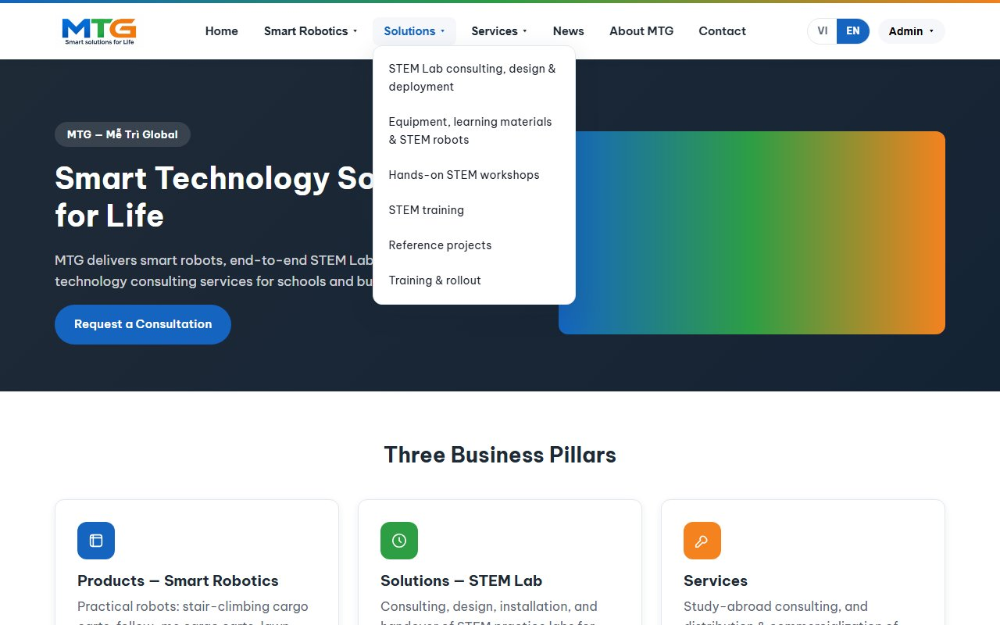

- **Language:** click **VI** / **EN** in the top-right corner. The choice is remembered.
- **Theme:** use the light/dark switch in the header (inside the account menu once you are logged in).
- **Equipment catalog:** *Solutions → Equipment, learning materials & STEM robots* lists every item by group; click a card for details.

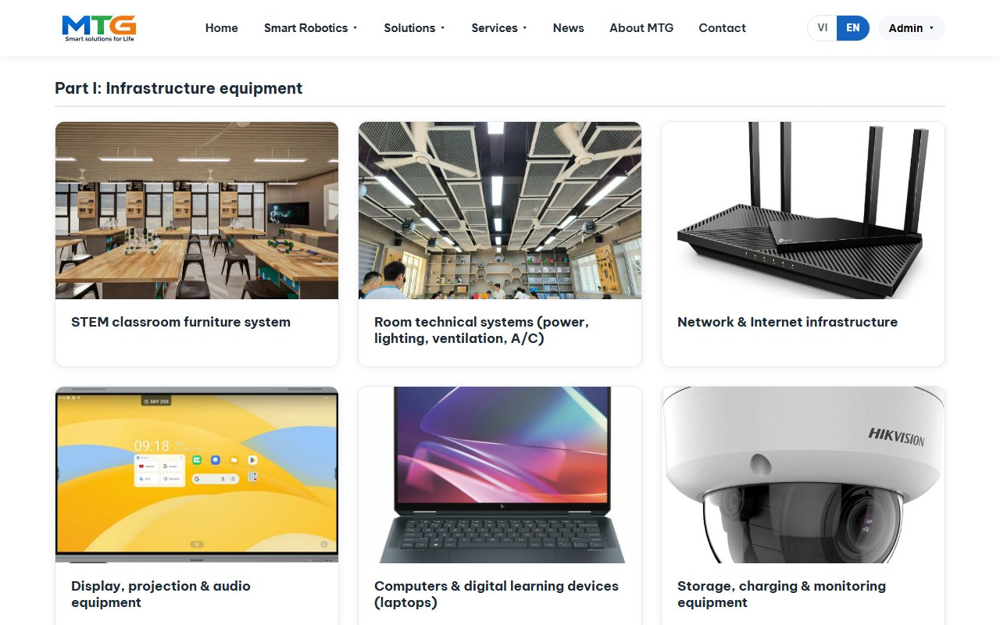

**Sending a consultation request.** Fill in the form on the **Contact** page (or on a robot or service page). Give your name, at least a phone number or an email, what you are interested in and a message, then send. MTG staff see it immediately in the admin panel.

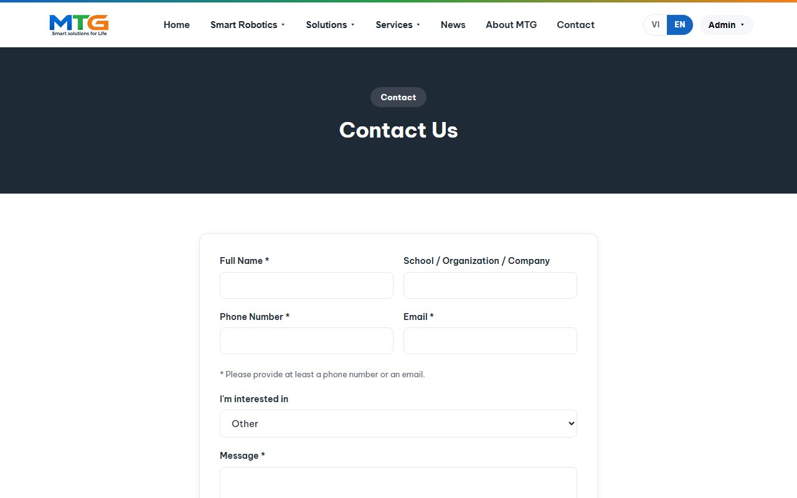

**Your account.** Click **Sign Up** to create an account (name, email, phone, school/company, password). Requests you send while logged in are linked to your account: **My Requests** (`/tai-khoan`) in the account menu shows each of them and its status. **Profile** (`/ho-so`) lets you edit your details and change your password.

#### 3.2 For staff (admin panel)

**Signing in.** Log in with an account that has the *Administrator* or *Owner* role (see [4.5 Create an admin account](#45-create-an-admin-account)), then open **Admin** in the account menu or go to `http://localhost:3000/admin`. The **Overview** page shows new requests, totals, customers, published news and charts.


**Sidebar map**

| Group | Item | What it manages | Address |
|---|---|---|---|
| — | Overview | Dashboard and statistics | `/admin` |
| Smart Robotics | Robot products | The 4 robots: text, photos, videos, specs | `/admin/robot` |
| Solutions | Consulting, design & deployment | Page editor (a) | `/admin/trang/stem-lab` |
| | Equipment, materials & STEM robots | Equipment catalog (b) | `/admin/thiet-bi` |
| | Hands-on STEM workshops | Page editor (c) | `/admin/trang/workshop` |
| | STEM training | Page editor (d) | `/admin/trang/dao-tao` |
| | Reference projects | Projects (e) | `/admin/du-an` |
| | Training & rollout | Page editor (f) | `/admin/trang/tap-huan` |
| Services | Services | Study abroad, distribution: text, packages, questions | `/admin/dich-vu` |
| News | News | Articles (published / hidden) | `/admin/tin-tuc` |
| About & Contact | Company info | Company profile, address, phone, email | `/admin/thong-tin-cong-ty` |
| | Partners | Partner logos and links | `/admin/doi-tac` |
| Management | Consultation requests | Request inbox | `/admin/yeu-cau` |
| | Users | Accounts and roles | `/admin/nguoi-dung` |
| | General settings | Logo, home hero, page banners | `/admin/cai-dat` |

**Everyday tasks**
- **Add / edit:** use the **+ Add …** button at the top of a list, or **Edit** on a row. Fill in both Vietnamese and English fields; an empty English field falls back to Vietnamese. Text fields are plain text — leave an empty line for a new paragraph, start a line with `- ` for a bullet list.
- **Photos and videos:** choose files in the form; they are uploaded when you save.
- **Order:** drag a row by its ⠿ handle. The new order is saved immediately and used on the website.
- **Search** (equipment list): type any word of the name. Matching words are highlighted; dragging is paused while a search is active.
- **Delete:** click **Delete** and confirm in the dialog (Esc, ×, or clicking outside cancels).
- **View page:** the round button at the bottom-right opens the matching public page.
- **Language of the admin:** VI / EN at the bottom of the sidebar (independent of the website language).


**Editing a Solutions page** (Consulting, Workshops, Training, Training & rollout). A page is a list of **sections**. Each section has a type — *Text*, *Info cards*, *Steps*, *Photos & videos*, *Statistics* or *Buttons* — and VI / EN fields.
- **Add section** at the bottom; drag the ⠿ handle to reorder; **Remove** to delete one.
- Inside a section, add, reorder or remove cards, steps, photos and buttons.
- Click **Save page**. If something is missing, the field is highlighted and nothing is lost.
- **Restore default content** puts the page back to its original text and photos.
- The page's banner (the dark strip at the top) is edited in **General settings** — the link at the top of the editor takes you there.

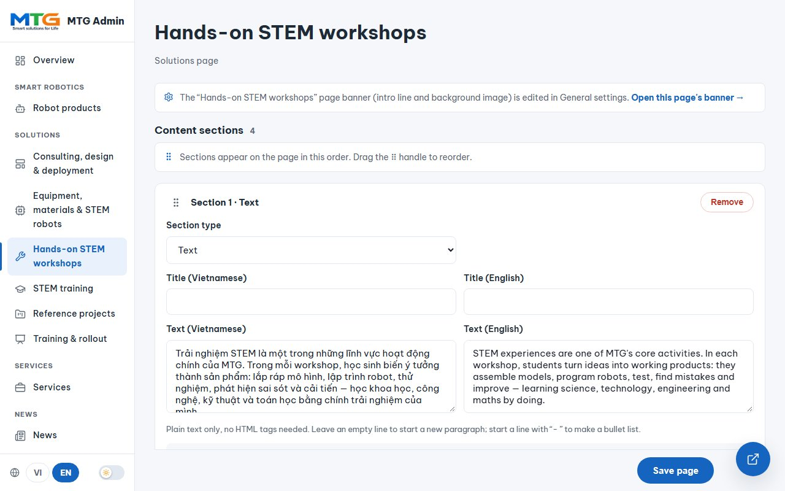

**General settings** (`/admin/cai-dat`) has three tabs:
- **Brand** — the company logo (header and footer of every page).
- **Home page (Hero)** — the large picture on the home page, and optional VI / EN title and description. Leave a box empty to keep the default text (shown greyed out).
- **Page banners** — one card per page, grouped like the menu: the intro line (VI / EN) and an optional background image. Detail pages (a product, project, service or article) use the background image of their list page.


**Company info** (`/admin/thong-tin-cong-ty`) holds the company profile (About MTG page) and the address, phone and email (About, Contact page and footer).

**Consultation requests** (`/admin/yeu-cau`). Every request from the website arrives here with the contact details, area of interest and message. Change the **Status** — *New → Contacted → Completed* — and it saves instantly; the buttons at the top filter by status. Customers see the same status under My Requests.

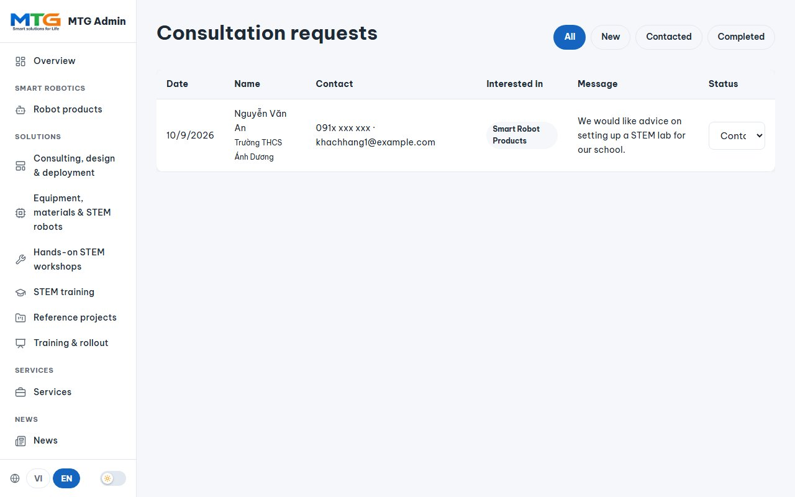

**Users and roles** (`/admin/nguoi-dung`)

| Role | Can do |
|---|---|
| **Owner** | Everything an administrator can, plus grant / remove admin rights and delete administrators or customers |
| **Administrator** | Manage all content and requests; delete customer accounts |
| **Customer** | Use the website, send and follow their own requests |

Nobody can delete or change their own account or an owner from the website; owners are managed from the command line (see 4.5).

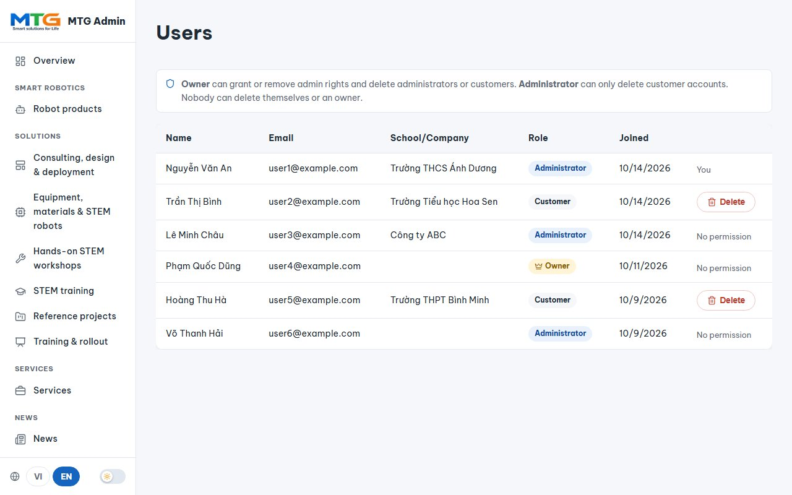

> The names, emails and phone numbers in these screenshots are sample data.

### 4. Installation and configuration (local)

#### 4.1 Requirements
- **Node.js 18 or newer** and npm — check with `node -v` and `npm -v`.
- **MongoDB** — a local MongoDB server (on Windows, the “MongoDB” service) or a MongoDB Atlas connection string.
- **Git**, to clone the repository.

#### 4.2 Get the code and install
```bash
git clone https://github.com/KClabio/MTGlobal.git
cd MTGlobal
npm install
```

#### 4.3 Configure `.env`
Copy the example file, then edit it:
```bash
cp .env.example .env        # Windows (cmd/PowerShell): copy .env.example .env
```

| Variable | Meaning | Local value |
|---|---|---|
| `PORT` | Port the site runs on | `3000` |
| `MONGO_URI` | MongoDB connection string | `mongodb://localhost:27017/mtglobal_db` |
| `SESSION_SECRET` | Secret used to sign login sessions — any long random string | e.g. the output of `node -e "console.log(require('crypto').randomBytes(32).toString('hex'))"` |
| `TRUST_PROXY` | Set only behind a reverse proxy (Nginx, Render…) | leave empty |
| `CLOUDINARY_CLOUD_NAME`, `CLOUDINARY_API_KEY`, `CLOUDINARY_API_SECRET` | Store uploads on Cloudinary instead of the local disk (needed on hosts whose disk is wiped on redeploy) | leave empty — uploads go to `public/uploads/` |

`.env` holds secrets and is never committed to git.

#### 4.4 Load the starting content and run
Load MTG's starting content (projects, robots, equipment catalog incl. VEX Robotics, services, Solutions pages, settings):
```bash
npm run seed
```
> ⚠️ `npm run seed` **deletes and recreates** Projects, Products (robots + equipment) and Services, and resets the Solutions pages to their default content. It also rewrites the company profile and address (Company info) — phone, email, banners and the home hero are kept. It does not touch users, partners, news or requests. Do not run it on a database whose content you have edited, unless you want to start over.
>
> The original source files (presentation slides, robot videos, logo) live in `source-assets/`, which is **not in the repository**. Without that folder the seed still loads all the text, but not those pictures and videos — upload them from the admin panel instead.

Start the server:
```bash
npm run dev     # development: restarts automatically when code changes
npm start       # plain start
```
When you see `MongoDB connected.` and `MTGlobal server running at http://localhost:3000`, open **http://localhost:3000**. Stop the server with `Ctrl + C`.

#### 4.5 Create an admin account
For safety, nobody can become an admin from the website. Grant the role from the command line:

1. Open `http://localhost:3000/dang-ky` and **sign up** with your name, email and password (this creates a normal *Customer* account).
2. In the project folder, run:
   ```bash
   npm run make-admin -- you@example.com            # Administrator
   npm run make-admin -- you@example.com --owner    # Owner (can manage other admins)
   npm run make-admin -- you@example.com --customer # back to Customer
   ```
   (Same as `node scripts/make-admin.js you@example.com [--owner | --customer]`.)
3. **Log in** again at `http://localhost:3000/dang-nhap` and open `http://localhost:3000/admin`.

Make at least one **Owner** — only an owner can give or remove admin rights from the website. The same command is the way back in if the owner account is lost.

#### 4.6 Common commands

| Command | What it does |
|---|---|
| `npm install` | Install dependencies |
| `npm run dev` | Start with auto-restart (development) |
| `npm start` | Start without auto-restart |
| `npm run seed` | Load / reset the starting content (see the warning above) |
| `npm run make-admin -- EMAIL [--owner \| --customer]` | Set an account's role |

#### 4.7 Troubleshooting
- **`MongoDB connection error` at start-up** — MongoDB is not running. On Windows start the service (`Start-Service MongoDB` in an administrator PowerShell), or point `MONGO_URI` to a running server / Atlas.
- **Port 3000 already in use** — stop the other program, or set another `PORT` in `.env`.
- **Images missing after cloning to another computer** — uploaded files (`public/uploads/`) and the database are not stored in git. Copy them from the original machine: back up with `mongodump --db mtglobal_db` and restore with `mongorestore`, and copy the `public/uploads/` folder.
- **Uploads disappear after a redeploy on a hosting platform** — that host has a temporary disk; fill in the three `CLOUDINARY_*` values.

#### 4.8 Project structure
```
config/       database connection
lib/          shared logic (settings, banners, page defaults, roles, i18n, validation)
locales/      vi.json / en.json — all interface text
middleware/   login checks, uploads
models/       MongoDB models (Product, Project, Service, Article, Partner, User, QuoteRequest, SiteSettings, SolutionPage)
routes/       public pages, accounts, admin panel
scripts/      seed, make-admin, data migrations
views/        EJS templates (public site and admin)
public/       CSS, JavaScript, images and videos (public/uploads = uploaded files, not in git)
server.js     application entry point
```

### 5. License

Copyright © 2026 Công ty TNHH Công nghệ Mễ Trì Global. **All rights reserved.** This is proprietary software — see [LICENSE](LICENSE). The website may be published publicly; the source code may not be copied, modified or distributed without written permission.

---

## Tiếng Việt

### Mục lục
1. [Tổng quan](#1-tổng-quan)
2. [Tính năng](#2-tính-năng)
3. [Hướng dẫn sử dụng](#3-hướng-dẫn-sử-dụng)
   - [3.1 Dành cho khách truy cập](#31-dành-cho-khách-truy-cập)
   - [3.2 Dành cho nhân viên (trang quản trị)](#32-dành-cho-nhân-viên-trang-quản-trị)
4. [Cài đặt và cấu hình (máy cục bộ)](#4-cài-đặt-và-cấu-hình-máy-cục-bộ)
5. [Giấy phép](#5-giấy-phép)

### 1. Tổng quan

MTGlobal là website Node.js giới thiệu ba lĩnh vực hoạt động của MTG:

- **Robotics thông minh** — các dòng robot ứng dụng thực tế (robot leo cầu thang, robot đi theo người, robot cắt cỏ, robot phục vụ gia đình).
- **Giải pháp** — tư vấn, thiết kế và triển khai phòng Lab STEM; thiết bị, học liệu và VEX Robotics; workshop trải nghiệm STEM; đào tạo STEM; dự án tham khảo; tập huấn & triển khai.
- **Dịch vụ** — tư vấn du học và phân phối sản phẩm công nghệ.

Mọi trang đều có **tiếng Việt và tiếng Anh**. Một máy chủ duy nhất chạy cả website công khai lẫn **trang quản trị** (`/admin`), nơi nhân viên chỉnh sửa toàn bộ nội dung mà không cần đụng đến mã nguồn.


### 2. Tính năng

**Website công khai**
- Trang chủ với phần mở đầu (hero), ba lĩnh vực hoạt động, nội dung nổi bật và logo đối tác.
- Menu: Trang chủ · Robotics thông minh · Giải pháp (6 trang) · Dịch vụ · Tin tức · Về MTG · Liên hệ.
- Danh mục thiết bị STEM theo từng phần (hạ tầng, thiết bị, VEX Robotics, học liệu số…), mỗi thiết bị có trang chi tiết.
- Dự án tham khảo, tin tức, giới thiệu công ty và thông tin liên hệ.
- **Biểu mẫu yêu cầu tư vấn** ở trang Liên hệ, trang robot và trang dịch vụ.
- Tài khoản khách hàng: đăng ký, đăng nhập, sửa hồ sơ và theo dõi yêu cầu của mình ở **Yêu cầu của tôi**.
- Chuyển ngôn ngữ (VI / EN) và giao diện sáng / tối.

**Trang quản trị**
- Thanh bên (sidebar) sắp xếp giống menu website nên dễ tìm.
- Thêm, sửa, xoá robot, thiết bị STEM, dự án, tin tức, đối tác; chỉnh sửa dịch vụ.
- **Kéo thả** để sắp xếp thứ tự hiển thị; **tìm kiếm** trong danh sách thiết bị dài (không phân biệt dấu: gõ `may in` sẽ ra “máy in”).
- Hộp thoại xác nhận trước khi xoá.
- Trình chỉnh sửa các trang Giải pháp (văn bản, thẻ thông tin, các bước, ảnh & video, số liệu, nút bấm).
- **Cài đặt chung**: logo, phần mở đầu trang chủ và banner của từng trang.
- Hộp thư yêu cầu tư vấn có theo dõi trạng thái, trang tổng quan có thống kê, quản lý người dùng và vai trò.
- Trang quản trị có nút VI / EN và chế độ sáng / tối riêng.

### 3. Hướng dẫn sử dụng

#### 3.1 Dành cho khách truy cập

**Xem website.** Dùng menu phía trên. *Robotics thông minh*, *Giải pháp* và *Dịch vụ* mở ra danh sách các trang con.

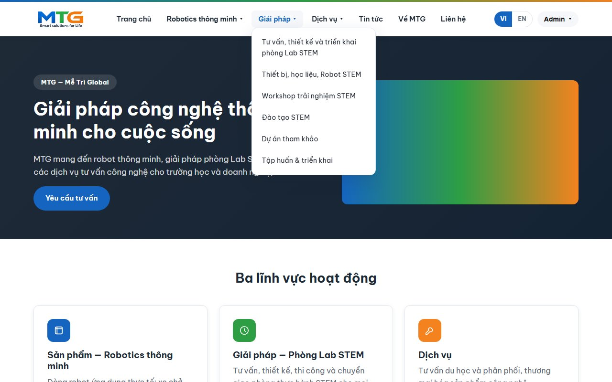

- **Ngôn ngữ:** bấm **VI** / **EN** ở góc trên bên phải; lựa chọn được ghi nhớ.
- **Giao diện:** dùng công tắc sáng/tối trên thanh menu (nằm trong menu tài khoản khi đã đăng nhập).
- **Danh mục thiết bị:** *Giải pháp → Thiết bị, học liệu, Robot STEM* liệt kê mọi thiết bị theo nhóm; bấm vào thẻ để xem chi tiết.

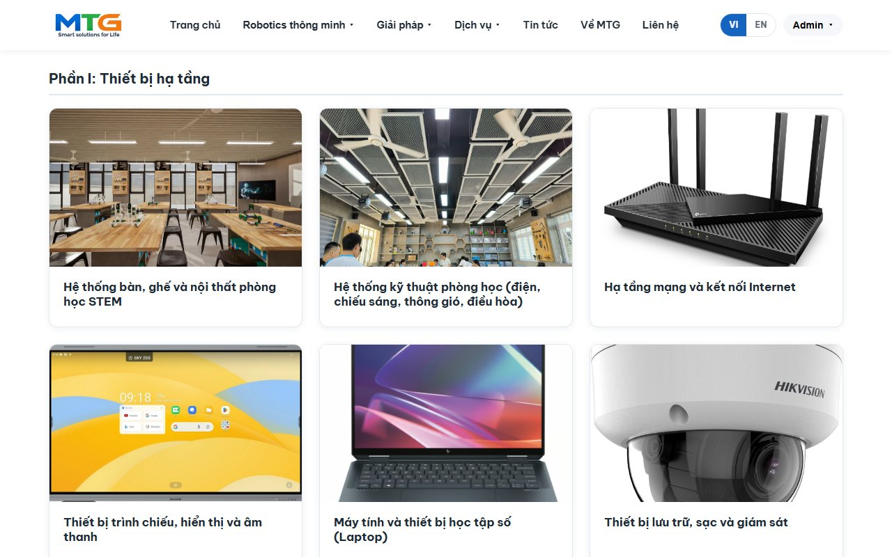

**Gửi yêu cầu tư vấn.** Điền biểu mẫu ở trang **Liên hệ** (hoặc trang robot, trang dịch vụ): họ tên, ít nhất số điện thoại hoặc email, lĩnh vực quan tâm và nội dung, rồi bấm gửi. Nhân viên MTG nhận được ngay trong trang quản trị.

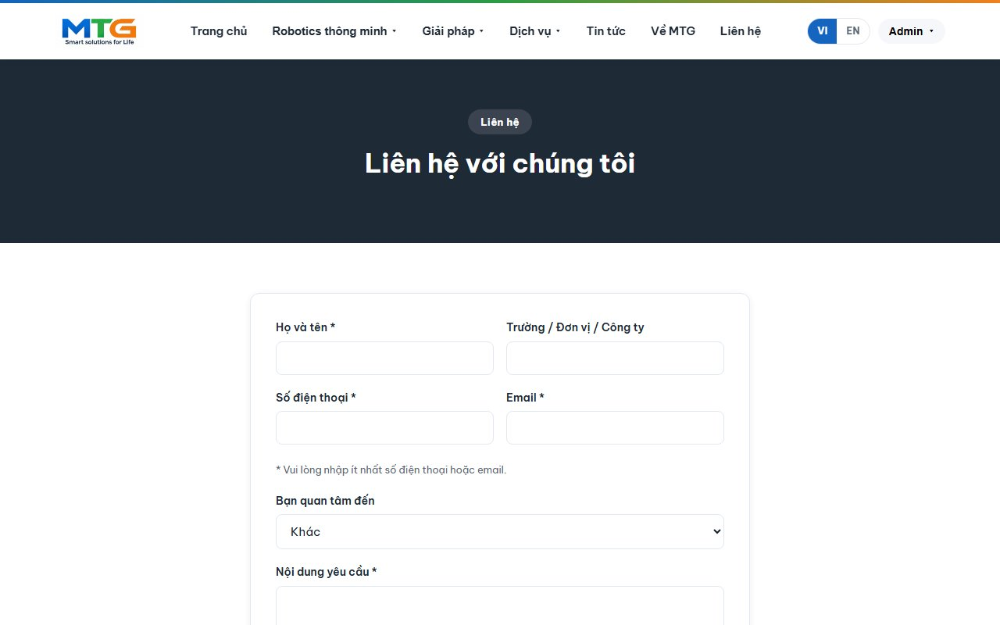

**Tài khoản của bạn.** Bấm **Đăng ký** để tạo tài khoản (họ tên, email, số điện thoại, trường/công ty, mật khẩu). Yêu cầu gửi khi đã đăng nhập được gắn với tài khoản của bạn: **Yêu cầu của tôi** (`/tai-khoan`) trong menu tài khoản hiển thị từng yêu cầu cùng trạng thái xử lý. **Hồ sơ** (`/ho-so`) để sửa thông tin và đổi mật khẩu.

#### 3.2 Dành cho nhân viên (trang quản trị)

**Đăng nhập.** Đăng nhập bằng tài khoản có vai trò *Quản trị viên* hoặc *Chủ sở hữu* (xem [4.5 Tạo tài khoản quản trị](#45-tạo-tài-khoản-quản-trị)), rồi chọn **Quản trị** trong menu tài khoản hoặc vào `http://localhost:3000/admin`. Trang **Tổng quan** hiển thị yêu cầu mới, tổng số, khách hàng, tin đã đăng và các biểu đồ.


**Sơ đồ thanh bên**

| Nhóm | Mục | Quản lý gì | Địa chỉ |
|---|---|---|---|
| — | Tổng quan | Bảng thống kê | `/admin` |
| Robotics thông minh | Sản phẩm robot | 4 dòng robot: nội dung, ảnh, video, thông số | `/admin/robot` |
| Giải pháp | Tư vấn, thiết kế & triển khai | Trình sửa trang (a) | `/admin/trang/stem-lab` |
| | Thiết bị, học liệu, Robot STEM | Danh mục thiết bị (b) | `/admin/thiet-bi` |
| | Workshop trải nghiệm STEM | Trình sửa trang (c) | `/admin/trang/workshop` |
| | Đào tạo STEM | Trình sửa trang (d) | `/admin/trang/dao-tao` |
| | Dự án tham khảo | Dự án (e) | `/admin/du-an` |
| | Tập huấn & triển khai | Trình sửa trang (f) | `/admin/trang/tap-huan` |
| Dịch vụ | Dịch vụ | Du học, phân phối: nội dung, gói dịch vụ, câu hỏi | `/admin/dich-vu` |
| Tin tức | Tin tức | Bài viết (đăng / ẩn) | `/admin/tin-tuc` |
| Về MTG & Liên hệ | Thông tin công ty | Giới thiệu công ty, địa chỉ, điện thoại, email | `/admin/thong-tin-cong-ty` |
| | Đối tác đồng hành | Logo và liên kết đối tác | `/admin/doi-tac` |
| Quản lý | Yêu cầu tư vấn | Hộp thư yêu cầu | `/admin/yeu-cau` |
| | Người dùng | Tài khoản và vai trò | `/admin/nguoi-dung` |
| | Cài đặt chung | Logo, hero trang chủ, banner các trang | `/admin/cai-dat` |

**Thao tác thường dùng**
- **Thêm / sửa:** bấm nút **+ Thêm …** ở đầu danh sách, hoặc **Sửa** ở từng dòng. Điền cả ô tiếng Việt và tiếng Anh; ô tiếng Anh để trống sẽ dùng nội dung tiếng Việt. Các ô văn bản là chữ thường — để một dòng trống để sang đoạn mới, bắt đầu dòng bằng `- ` để tạo danh sách.
- **Ảnh và video:** chọn tệp trong biểu mẫu; tệp được tải lên khi bấm lưu.
- **Thứ tự:** kéo dòng bằng tay nắm ⠿. Thứ tự mới được lưu ngay và áp dụng trên website.
- **Tìm kiếm** (danh sách thiết bị): gõ bất kỳ từ nào trong tên. Từ khớp được tô sáng; khi đang tìm kiếm thì tạm dừng kéo thả.
- **Xoá:** bấm **Xoá** và xác nhận trong hộp thoại (Esc, dấu × hoặc bấm ra ngoài để huỷ).
- **Xem trang:** nút tròn ở góc dưới bên phải mở trang công khai tương ứng.
- **Ngôn ngữ trang quản trị:** VI / EN ở cuối thanh bên (độc lập với ngôn ngữ website).


**Sửa một trang Giải pháp** (Tư vấn, Workshop, Đào tạo, Tập huấn). Mỗi trang là một danh sách **mục**. Mỗi mục có một loại — *Văn bản*, *Thẻ thông tin*, *Các bước*, *Ảnh & video*, *Số liệu* hoặc *Nút bấm* — cùng các ô VI / EN.
- **Thêm mục** ở cuối trang; kéo tay nắm ⠿ để đổi thứ tự; **Xoá** để bỏ một mục.
- Trong mỗi mục có thể thêm, sắp xếp, xoá thẻ, bước, ảnh và nút.
- Bấm **Lưu trang**. Nếu thiếu thông tin, ô cần sửa được đánh dấu và không mất nội dung đã nhập.
- **Khôi phục nội dung mặc định** đưa trang về văn bản và hình ảnh ban đầu.
- Banner của trang (dải màu tối ở đầu trang) được sửa trong **Cài đặt chung** — liên kết ở đầu trình sửa sẽ đưa bạn tới đó.

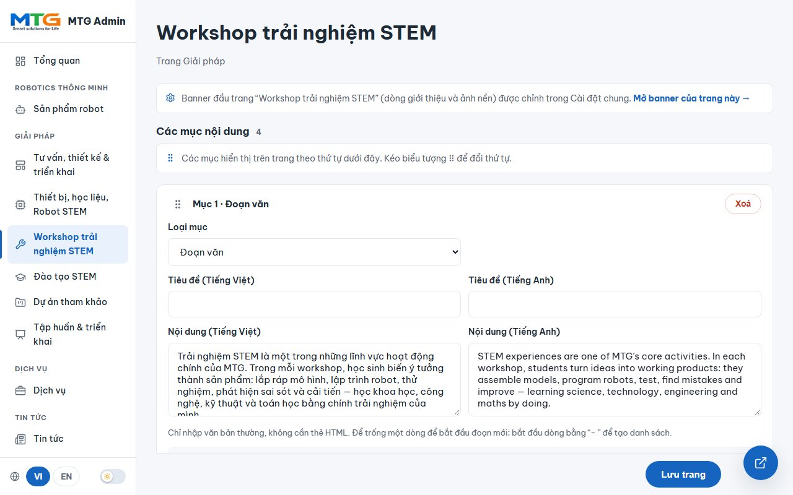

**Cài đặt chung** (`/admin/cai-dat`) gồm ba thẻ:
- **Thương hiệu** — logo công ty (ở đầu và chân mọi trang).
- **Trang chủ (Hero)** — ảnh lớn ở trang chủ, cùng tiêu đề và mô tả VI / EN (tuỳ chọn). Để trống ô nào thì giữ nội dung mặc định (hiện mờ trong ô).
- **Banner các trang** — mỗi trang một thẻ, nhóm theo menu: dòng giới thiệu (VI / EN) và ảnh nền tuỳ chọn. Trang chi tiết (sản phẩm, dự án, dịch vụ, bài viết) dùng chung ảnh nền của trang danh sách.


**Thông tin công ty** (`/admin/thong-tin-cong-ty`) chứa phần giới thiệu công ty (trang Về MTG) và địa chỉ, điện thoại, email (trang Về MTG, Liên hệ và chân trang).

**Yêu cầu tư vấn** (`/admin/yeu-cau`). Mọi yêu cầu gửi từ website đều về đây kèm thông tin liên hệ, lĩnh vực quan tâm và nội dung. Đổi **Trạng thái** — *Mới → Đã liên hệ → Hoàn tất* — là được lưu ngay; các nút phía trên để lọc theo trạng thái. Khách hàng thấy cùng trạng thái trong mục Yêu cầu của tôi.

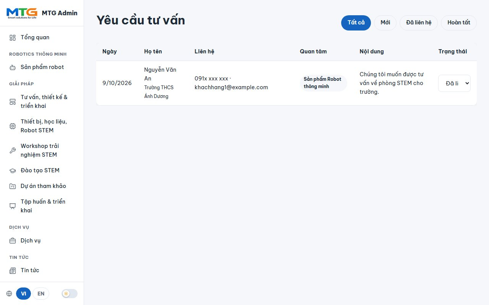

**Người dùng và vai trò** (`/admin/nguoi-dung`)

| Vai trò | Được làm |
|---|---|
| **Chủ sở hữu** | Mọi việc của quản trị viên, thêm cấp / thu hồi quyền quản trị và xoá quản trị viên hoặc khách hàng |
| **Quản trị viên** | Quản lý toàn bộ nội dung và yêu cầu; xoá tài khoản khách hàng |
| **Khách hàng** | Dùng website, gửi và theo dõi yêu cầu của mình |

Trên website không ai có thể tự xoá / đổi vai trò của chính mình hoặc của chủ sở hữu; chủ sở hữu được quản lý bằng dòng lệnh (xem mục 4.5).

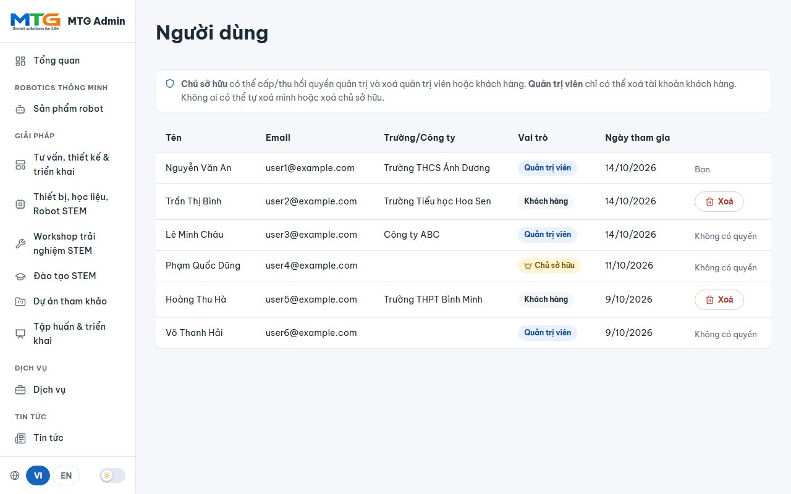

> Họ tên, email và số điện thoại trong các ảnh chụp màn hình là dữ liệu mẫu.

### 4. Cài đặt và cấu hình (máy cục bộ)

#### 4.1 Yêu cầu
- **Node.js 18 trở lên** và npm — kiểm tra bằng `node -v` và `npm -v`.
- **MongoDB** — máy chủ MongoDB trên máy (trên Windows là dịch vụ “MongoDB”) hoặc chuỗi kết nối MongoDB Atlas.
- **Git**, để tải mã nguồn về.

#### 4.2 Tải mã nguồn và cài đặt
```bash
git clone https://github.com/KClabio/MTGlobal.git
cd MTGlobal
npm install
```

#### 4.3 Cấu hình `.env`
Sao chép tệp mẫu rồi chỉnh sửa:
```bash
cp .env.example .env        # Windows (cmd/PowerShell): copy .env.example .env
```

| Biến | Ý nghĩa | Giá trị khi chạy trên máy |
|---|---|---|
| `PORT` | Cổng chạy website | `3000` |
| `MONGO_URI` | Chuỗi kết nối MongoDB | `mongodb://localhost:27017/mtglobal_db` |
| `SESSION_SECRET` | Khoá bí mật để ký phiên đăng nhập — một chuỗi ngẫu nhiên dài | ví dụ kết quả của `node -e "console.log(require('crypto').randomBytes(32).toString('hex'))"` |
| `TRUST_PROXY` | Chỉ đặt khi chạy sau reverse proxy (Nginx, Render…) | để trống |
| `CLOUDINARY_CLOUD_NAME`, `CLOUDINARY_API_KEY`, `CLOUDINARY_API_SECRET` | Lưu tệp tải lên ở Cloudinary thay vì ổ đĩa (cần cho dịch vụ hosting bị xoá ổ đĩa khi triển khai lại) | để trống — tệp tải lên nằm ở `public/uploads/` |

`.env` chứa thông tin bí mật và không bao giờ được đưa lên git.

#### 4.4 Nạp nội dung ban đầu và chạy
Nạp nội dung ban đầu của MTG (dự án, robot, danh mục thiết bị gồm VEX Robotics, dịch vụ, các trang Giải pháp, cài đặt):
```bash
npm run seed
```
> ⚠️ `npm run seed` **xoá và tạo lại** Dự án, Sản phẩm (robot + thiết bị) và Dịch vụ, đồng thời đưa các trang Giải pháp về nội dung mặc định. Lệnh này cũng ghi đè phần giới thiệu công ty và địa chỉ (Thông tin công ty) — điện thoại, email, banner và hero trang chủ được giữ nguyên. Lệnh không động đến người dùng, đối tác, tin tức hay yêu cầu tư vấn. Đừng chạy trên cơ sở dữ liệu đã chỉnh sửa nội dung, trừ khi bạn muốn làm lại từ đầu.
>
> Các tệp gốc (slide thuyết trình, video robot, logo) nằm trong thư mục `source-assets/`, **không có trong repository**. Không có thư mục này, lệnh seed vẫn nạp toàn bộ văn bản nhưng không có các ảnh và video đó — hãy tải chúng lên từ trang quản trị.

Chạy máy chủ:
```bash
npm run dev     # khi phát triển: tự khởi động lại khi mã thay đổi
npm start       # chạy bình thường
```
Khi thấy `MongoDB connected.` và `MTGlobal server running at http://localhost:3000`, mở **http://localhost:3000**. Dừng máy chủ bằng `Ctrl + C`.

#### 4.5 Tạo tài khoản quản trị
Để an toàn, không ai có thể tự trở thành quản trị viên từ website. Cấp quyền bằng dòng lệnh:

1. Mở `http://localhost:3000/dang-ky` và **đăng ký** bằng họ tên, email, mật khẩu (tạo ra tài khoản *Khách hàng* thông thường).
2. Trong thư mục dự án, chạy:
   ```bash
   npm run make-admin -- ban@example.com            # Quản trị viên
   npm run make-admin -- ban@example.com --owner    # Chủ sở hữu (quản lý các quản trị viên khác)
   npm run make-admin -- ban@example.com --customer # trở lại Khách hàng
   ```
   (Tương đương `node scripts/make-admin.js ban@example.com [--owner | --customer]`.)
3. **Đăng nhập** lại tại `http://localhost:3000/dang-nhap` và mở `http://localhost:3000/admin`.

Hãy tạo ít nhất một **Chủ sở hữu** — chỉ chủ sở hữu mới cấp hoặc thu hồi quyền quản trị trên website. Lệnh trên cũng là cách lấy lại quyền nếu mất tài khoản chủ sở hữu.

#### 4.6 Các lệnh thường dùng

| Lệnh | Tác dụng |
|---|---|
| `npm install` | Cài đặt thư viện |
| `npm run dev` | Chạy, tự khởi động lại (khi phát triển) |
| `npm start` | Chạy, không tự khởi động lại |
| `npm run seed` | Nạp / đặt lại nội dung ban đầu (xem cảnh báo ở trên) |
| `npm run make-admin -- EMAIL [--owner \| --customer]` | Đặt vai trò cho tài khoản |

#### 4.7 Xử lý sự cố
- **Báo `MongoDB connection error` khi khởi động** — MongoDB chưa chạy. Trên Windows, khởi động dịch vụ (`Start-Service MongoDB` trong PowerShell quyền quản trị), hoặc trỏ `MONGO_URI` tới máy chủ đang chạy / Atlas.
- **Cổng 3000 đã được dùng** — tắt chương trình kia, hoặc đặt `PORT` khác trong `.env`.
- **Thiếu ảnh khi tải mã về máy khác** — tệp đã tải lên (`public/uploads/`) và cơ sở dữ liệu không được lưu trong git. Sao chép từ máy gốc: sao lưu bằng `mongodump --db mtglobal_db`, khôi phục bằng `mongorestore`, và chép thư mục `public/uploads/`.
- **Tệp tải lên biến mất sau khi triển khai lại trên dịch vụ hosting** — dịch vụ đó dùng ổ đĩa tạm; hãy điền ba biến `CLOUDINARY_*`.

#### 4.8 Cấu trúc dự án
```
config/       kết nối cơ sở dữ liệu
lib/          logic dùng chung (cài đặt, banner, nội dung mặc định, vai trò, đa ngôn ngữ, kiểm tra dữ liệu)
locales/      vi.json / en.json — toàn bộ chữ trên giao diện
middleware/   kiểm tra đăng nhập, tải tệp lên
models/       mô hình MongoDB (Product, Project, Service, Article, Partner, User, QuoteRequest, SiteSettings, SolutionPage)
routes/       trang công khai, tài khoản, trang quản trị
scripts/      seed, make-admin, chuyển đổi dữ liệu
views/        giao diện EJS (website và trang quản trị)
public/       CSS, JavaScript, ảnh và video (public/uploads = tệp tải lên, không có trong git)
server.js     điểm khởi động ứng dụng
```

### 5. Giấy phép

Bản quyền © 2026 Công ty TNHH Công nghệ Mễ Trì Global. **Bảo lưu mọi quyền.** Đây là phần mềm độc quyền — xem [LICENSE](LICENSE). Website có thể được công khai; mã nguồn không được sao chép, chỉnh sửa hay phân phối khi chưa có sự cho phép bằng văn bản.
